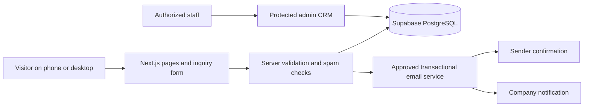

> Historical planning baseline: see HANDOVER.md and REMAINING-WORK-CHECKLIST.md for current implementation and outstanding work.

# Crunchify B2B website: complete trial plan

**Planning baseline:** 3 November 2026. This is a build plan, not a completed website. The PNG boards are static concepts and have not been approved by Mathew. The internal goal is five days; the agreement gives ten working days from the conditions stated in the agreement. Five days does not change that term.

**Outcome:** deliver the required, mobile-first homepage and working wholesale inquiry system; then complete and demonstrate the optional features for the performance bonus. The bonus is **up to PHP 2,000**, subject to the company's acceptance and assessment; no particular amount per feature is promised.

## 1. What governs the work

1. The freelance trial agreement attached to [Mathew's post-call email](https://mail.google.com/mail/u/?authuser=johnapogi4ever%40gmail.com#all/1a1a0cdad2d28203) defines the core deliverables, technology, optional bonus work, delivery and evaluation. It also refers to a separate written post-kickoff summary; no separate final acceptance summary was located in the project emails reviewed. Incorporate it if received, and flag any discrepancy rather than inventing approval.
2. [Mathew's original project email](https://mail.google.com/mail/u/?authuser=johnapogi4ever%40gmail.com#all/1a199bbb7f50258e) adds mobile-first, a Lighthouse target above 90, basic SEO, and the broader original product brief. The agreement distinguishes its core work from optional bonus features.
3. The attached B2B dossier supplies the four products and the distributor form content. The [Website Trial Drive](https://drive.google.com/drive/folders/1WFuVorKtyr3mYyX4Az7BgvHsEHGu_LUY) supplies the brand book, logos, typography files, product photography and packaging. Follow the brand kit for visual identity.
4. The user requested visual identity and imagery **only from the Website Trial Drive**. The [23 UI boards](https://drive.google.com/drive/folders/1a7WuEwidqcS4L-JRUWOiPErKxeDX9XYZ) show proposed layouts using that kit. Page names, screen arrangements and extra CRM interactions are design/implementation proposals, not instructions written in the brand book.
5. A sent email describes its attached PDF as the signed agreement. The signature in that attachment, Mathew's receipt, any countersignature, the initial payment and the official start date were not independently verified. Do not infer the formal deadline from the internal five-day goal.

## 2. Delivery priorities

| Priority | Work | Required outcome |
| --- | --- | --- |
| Core | Homepage | B2B hero with **Become a Wholesale Partner**, the four named products, a why-stock-us section, paths to the inquiry form and a footer with company contact details. |
| Core | Wholesale inquiry system | All nine agreed fields, server validation and spam protection; record and attribution in PostgreSQL; confirmation to the sender and notification to the company; clear success/error states. |
| Core | Technical delivery | Next.js App Router, TypeScript, Tailwind, PostgreSQL with migrations and seeds, Supabase as plain Postgres, Vercel deployment with shareable preview, environment configuration, Docker readiness and Git repository handover. |
| Bonus | Product and wholesale pages | Product detail pages and a useful wholesale page. The catalog and category filter are part of the earlier brief and proposed navigation. |
| Bonus | Brand/media partner form | A separate working collaboration inquiry path; its exact fields, recipients and handling are proposed until the company confirms them. |
| Bonus | Admin CRM | A protected staff area to view and follow up on inquiries. The precise status options and editing features are proposals for acceptance. |
| Bonus | VPS migration | A real, verified migration to an approved private VPS. A Dockerfile or local container alone does **not** complete this bonus. |

Finish and test the core before treating optional work as delivered. The four bonus items remain part of the target, with VPS completion dependent on approved infrastructure, access and acceptance criteria.

## 3. Pages, routes and existing visual references

These route names are proposed. The board numbers are filenames in `wireframes-v3/` and in the shared design folder. Screens of the same page show different viewport sizes or scroll positions, not extra separate pages.

| Page or state | Scope | Content and behavior | Boards |
| --- | --- | --- | --- |
| Home `/` | Core | Header, hero and wholesale CTA; featured Banana, Jackfruit, Apple and Broccoli Crunch; why stock us; contact and footer. Each CTA leads to the appropriate page or form. | `01`, mobile overview `11`, full mobile `23`, navigation/footer `16` |
| Wholesale inquiry `/inquire` | Core | One mobile-friendly form with all agreed fields, attribution, validation, submit, loading, success and retry states. | `05`, `06`, mobile `11`, `18`, `20` |
| Products `/products` | Earlier brief / proposed bonus navigation | Show the four actual products with All/Fruit/Vegetable filters and links to details. Do not create fictional products to satisfy an earlier sample count. | `02`, mobile `11`, `17` |
| Product `/products/[slug]` | Bonus | Reusable detail template for each of the four products; supplied photo, confirmed ingredients/specs and request-quote action. Carry product selection into the inquiry. | `03`, `14`, mobile `17` |
| Wholesale `/wholesale` | Bonus | Explain the distributor/reseller opportunity, product range and process, then link to the inquiry form. Include MOQ, territories, lead times and FAQs only when verified. | `04`, mobile `18` |
| Brand/media `/partners` | Bonus | Separate collaboration form with name, organization, email, collaboration type and message as proposed fields. Validate and route safely. | `07`, mobile `20` |
| Staff sign-in `/admin/login` | Bonus | Separate login, reachable from the footer, mobile menu or direct URL. No public registration; useful error and sign-out paths. | `08`, mobile `16` |
| Admin inquiry list `/admin` | Bonus | Authorized staff see inquiries; proposed search, type/status filter, status summary and open action. Stacked cards replace the desktop table on mobile. | `09`, mobile `19`, empty state `21` |
| Admin inquiry detail `/admin/inquiries/[id]` | Bonus | Authorized staff can read all submitted fields and attribution; proposed status and internal note can be saved and checked. | `10`, mobile `19`, `22` |
| Privacy and not-found `/privacy`, `404` | Supporting | Company-approved privacy wording and a contact path; clear return path when a page is missing. | `12`, mobile `21` |
| Shared system and brand | Supporting | One consistent header, footer, buttons, form controls, visual treatments and inquiry-to-email flow. | `13`, `15`, mobile `16` |

### Homepage concept corrections and remaining implementation work

- Corrected boards `01`, `11` and `23` now show the required why-stock-us section on the homepage, covering simple ingredients, no artificial sweeteners and the range of flavors. Implement it on the actual homepage; board `04` is a separate bonus page.
- The corrected hero and navigation use **Become a Wholesale Partner**, as named in the agreement. Connect those buttons to the real inquiry form and retain readable wrapping on narrow screens.
- The corrected footer shows the inquiry path and website/social channels supplied in the dossier. The user confirmed Mathew has not provided a public business email or phone; obtain those details and add them before final core delivery. Do not invent them. Verify the company wants each supplied channel displayed.
- The forms and admin boards are images only. Implement real input controls, every agreed field, validation, saved-data behavior, emails and access restrictions. The second form image is a continuation of one form, not a new step or optional section.
- The desktop and mobile inquiry details need to show the actual saved message, product selections, phone, business type, territory, volume and attribution, not only the example placeholder values.
- The product and wholesale concepts omit some possible specs, MOQ and lead-time information because it is unconfirmed. Keep them omitted or clearly pending until the company supplies accurate details.

## 4. Mobile-first design and brand rules

- Begin with a single-column small-screen layout and progressively expand for tablets and desktops. Do not shrink a desktop page to fit a phone. Use spaced sections, natural scrolling, readable labels and full-width primary actions where useful.
- Retain the mobile-specific arched crop of the supplied product photo, generous whitespace and simple menu shown in the boards. The crop is possible with `border-radius` and `object-fit`; it is not a new image or altered logo. Avoid crowding, forced carousels and decorative overlays on content.
- Plan for at least 44 × 44 CSS-pixel interactive targets, readable body/input type around 16 CSS pixels, visible focus, meaningful labels and errors, keyboard operation, zoom and reduced motion. Verify at 320, 375/390, 768, 1024 and 1440 CSS pixels and with real mobile-browser interaction when available.
- Use the brand-book primary brown `#8F5035`, cream `#FFF0C7`, secondary green `#1C925D`, white `#FFFFFF`, and the book's neutral/flavor colors. The darker broccoli green `#566C30` is a kit color used in the concepts for white-button contrast. Check actual text, hover and focus contrast in the built UI.
- Use supplied logos as designed: correct proportions, approved color, clear space, full opacity and no added effects. The current concept uses supplied white-pouch mockups, but some printed mockup weights and certification marks are not confirmed by the dossier. Verify the current package, label weights and claims with the company before publishing.
- The brand book specifies **Talina Regular** and **Antipasto Pro**. The supplied font files are demo/trial files with incomplete characters or watermarks, and the user confirmed no complete licensed files have been provided. Obtain complete, licensed web fonts before production. Do not silently substitute Poppins or ship the trial limitations as a finished brand implementation. Decide an accessible temporary development fallback if needed, clearly marked as temporary.

## 5. Core inquiry: fields and behavior

**Agreed fields:** company name; contact person; email; phone/WhatsApp; business type; territory/location; estimated monthly volume; products of interest; message. The dossier lists distributor, reseller, retailer and other as business types, and all four products as choices. Confirm which fields are mandatory and the permitted volume format before final validation.

1. A visitor opens the form from the homepage, wholesale page or product quote link. A product-specific link may preselect a product, while still allowing edits.
2. Capture the source page and UTM parameters without exposing or modifying private data. Define how the original landing source is retained across navigation; use a minimal, approved approach and honor company privacy wording.
3. Validate on the server, bound input lengths, reject malformed values and apply spam protection. Client-side checks improve feedback but do not replace server checks. Give accessible field-specific errors and retain entries on failure.
4. Save the complete inquiry and attribution to PostgreSQL. Ensure repeated submissions do not silently create unintended duplicates. Do not display a successful save if the database write fails.
5. Send a confirmation to the inquirer and a notification to the company's approved address. Use a verified sender and an approved email provider. Record delivery attempts or failures separately from the database save, and implement an actual, tested retry/recovery process if using an outbox. Do not claim an email was delivered merely because an inquiry was saved.
6. Show clear loading, success, invalid-input and error/retry states. Verify both requested email messages using test addresses, including what happens when the email provider or database is unavailable.

## 6. Architecture and modules

- **Design system:** brand tokens, typography, header/footer, mobile navigation, buttons, inputs, labels, status messages, cards and photo treatments. Use accessible native controls and real content.
- **Product content:** a typed data source for the four supplied products and their approved photos, ingredients and confirmed specs. Seed or manage content in one place; do not assume Apple pack size or current packaging from a conflicting mockup.
- **Inquiry service:** a Next.js server-side boundary for validation, attribution, spam checks, persistence and honest outcomes. A small database-backed delivery log/outbox is a proposed way to keep email failures visible; a real worker, scheduled trigger or documented manual recovery is needed for retries. Serverless background work must not be assumed to run after a response ends.
- **Database:** Supabase used as plain PostgreSQL, as specified. Include versioned migrations and safe seed data. Likely records are products, inquiries, selected products and email delivery attempts; admin users, sessions and notes depend on the chosen auth design. Keep development/test data separate from real leads.
- **Admin and authorization:** use a reviewed authentication/session solution compatible with the required stack; the provider is not yet chosen. Validate authorization on every admin page, server action and API, not just the menu or login screen. Provide secure sessions, sign-out, safe error handling and appropriate protection for write operations. Do not expose secrets or leads in the client bundle, logs or a public repository.
- **Email:** provider, sender domain and recipient are pending. The system must be able to send and verify both agreed messages; documentation alone does not satisfy this requirement.
- **Deployment:** Vercel deployment and a shareable preview are core; Docker readiness is also core. The optional VPS item requires an actual company-approved host, configuration, migration, verification and a rollback plan. Database, email, secrets, backups and ongoing ownership must be accounted for.
- **Code organization:** thin App Router pages with feature-owned product, inquiry and admin modules, shared UI primitives and server-only database/email access. Keep modules proportionate to this trial; route names and the implementation library are proposals.

## 7. Five-day execution target

Days are work blocks rather than calendar promises. Each gate needs a working result; outstanding access or company input can move bonus work beyond the target without changing the formal agreement.

| Day | Work | Gate / evidence |
| --- | --- | --- |
| 1 | Translate the corrected homepage concept into the application; secure access to a private Git repository, Vercel and Supabase; confirm brand assets and fonts; implement mobile-first shared UI and the full required homepage. Prepare an early preview. | Homepage navigation, four products, exact wholesale CTA, why-stock-us and contact/footer are present in a real preview, subject to company inputs. |
| 2 | Create PostgreSQL migrations and safe seed data; implement all wholesale fields, attribution, server validation and spam protection; connect approved email delivery and all form states. | A test inquiry is saved with correct source/UTM data; sender confirmation and company notification are observed; invalid input and failure/retry paths are checked. |
| 3 | Implement product listing/filter and the four detail variants, quote preselection, wholesale page, and brand/media form. | Product and partner journeys work on mobile and desktop; only verified content is shown; bonus forms are saved/routed as agreed. |
| 4 | Implement authenticated admin CRM and mobile cards/details; test unauthorized access; make the app Docker-ready. If approved VPS access is ready, migrate and verify the app and its dependencies. Share preview for the agreed consolidated review. | Staff sign-in and inquiry follow-up work; unauthorized access is denied; Docker build is tested; VPS migration has an actual receipt of success or is explicitly pending. |
| 5 | Apply the available consolidated feedback; run functional, mobile, accessibility, performance, SEO and security checks; fix failures; prepare repository, environment documentation and handover. | Clean build, end-to-end evidence, shareable Vercel preview, handover instructions and an honest record of any uncompleted bonus items. |

## 8. Verification and acceptance evidence

- **Brand and homepage:** verify the logo, colors, licensed fonts and approved assets against the kit; inspect the full homepage, exact CTA, all four products, required why-stock-us content and confirmed contact details.
- **Wholesale inquiry:** submit valid test data on a phone-sized viewport; inspect the saved record and selected products, source page and UTMs; verify actual sender and company email receipts. Check all required fields, invalid input, spam/rate limiting, database failure, email failure and duplicate/retry handling.
- **Bonus journeys:** visit each product page and filter; ensure quote selection reaches the form; exercise wholesale and media inquiry flow; test staff sign-in/out, unauthenticated denial, list/search, complete detail and changes on mobile and desktop.
- **Accessibility and responsiveness:** inspect 320, 375/390, 768, 1024 and 1440 CSS-pixel layouts; check real keyboard and screen-reader behavior, focus, labels, contrast, zoom, wrapping, touch targets and no horizontal clipping. Record actual browsers and sizes tested.
- **Quality:** run the project's lint, typecheck/build and appropriate critical-flow tests. Measure Lighthouse on agreed representative pages and conditions; above 90 is the original target, not a result to claim without measurement. Verify metadata, link behavior, image loading and meaningful errors.
- **Delivery:** exercise the deployed Vercel preview from browser through server, database and emails. Verify migrations/seeds on a clean environment, keep the Git repository private and hand over setup, environment-variable names, ownership, backups and deployment instructions. Test Docker when available. Demonstrate a real VPS only if the bonus is claimed.

## 9. Inputs needed to finish

| Input | Why it matters | Status / safe default |
| --- | --- | --- |
| Written post-call acceptance summary and bonus criteria | The agreement refers to it and makes acceptance company-dependent. | Not located as a separate summary in the emails reviewed; do not claim approval of proposed details. |
| Verified production/web licenses and full Talina/Antipasto files | Supplied demos have missing glyphs or watermark behavior. | The user confirms the complete files have not been provided; needed for an exact production brand match. |
| Company business email, phone and approved sender/recipient/domain | Core footer and both transactional emails need real destinations. | The user confirms the email and phone have not been provided; use only dossier-supplied channels in the concept, and do not guess. |
| Private Git, Vercel and Supabase ownership/access | Required repository, preview and database. | Local scaffold exists; remote/services are not configured. |
| Required fields, privacy/consent and data retention | Needed for form rules, disclosure and handling leads. | Proposed field list exists; company must confirm policy and required/optional rules. |
| Current packaging and product details | Avoid conflicting mockups or unsupported specs. | Four products are supplied; Apple size and current Banana packaging require confirmation. A supplied white-pouch studio image shows a different printed weight from the dossier's Banana sizes and contains certification-style marks that have not been verified. Treat these as mockups until the company approves production assets and claims. |
| MOQ, lead times, territories, FAQ and retailer identities | Useful optional wholesale content. | Not supplied as confirmed values; omit until verified. |
| CRM roles, desired statuses and staff onboarding | Admin CRM details are not fully specified. | Current list/filter/notes are proposals. |
| Approved VPS, access, costs, mail, domain and migration criteria | Required to demonstrate the optional migration. | Not configured; Docker readiness alone is not migration. |
| Timing of feedback and official start | Determines what can be completed within five days and the agreement's term. | An attachment described as signed was sent; its signature, payment, receipt and start date remain unverified. |

## 10. Current status and source links

- **Available:** local Next.js/TypeScript/Tailwind placeholder, project materials, a Dockerfile and a local PostgreSQL compose definition; 23 visual concept boards; and a separate local HTML/CSS homepage concept used to capture the corrected desktop and mobile designs. The homepage concept has been checked for horizontal overflow and its menu at representative widths, but its page links are not implemented application routes. An earlier scaffold lint/build passed, but neither result is evidence of a finished project.
- **Not yet implemented or connected:** the actual branded site, inquiry API, database schema/migrations/seeds, transactional email, admin authentication/CRM, Vercel deployment, Git remote and actual VPS migration. Docker was not available when previously checked; its image has not been tested.
- The source archive and prior design drafts are excluded from Git. For the working website, use only needed company-supplied assets in a private, company-controlled repository or approved storage, with appropriate handover. Never put secrets, real leads or the entire confidential reference archive into Git.
- Detailed checklist: [`REQUIREMENTS-TRACEABILITY.md`](REQUIREMENTS-TRACEABILITY.md). Visual notes: [`VISUAL-DIRECTION-V3.md`](VISUAL-DIRECTION-V3.md). Local source files: `reference/email/[Dematera] Freelance Trial Agreement.pdf`, `reference/email/B2B Website Dossier.pdf`, and `reference/drive/Crunchify Brand Book Design.pdf`.
